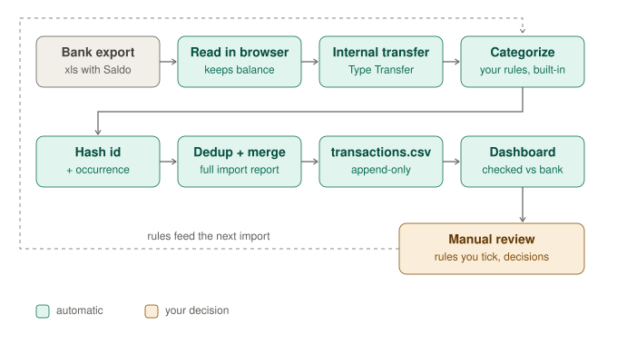

# Quietbook

A private, offline dashboard for your personal finances. Drop in the monthly export from your bank
(xlsx, xls or csv); Quietbook files every transaction into a fixed set of categories, keeps out what
isn't income or spending (transfers between your own accounts, investments), and shows where the
money went.

Everything runs on your own computer: one HTML page and a small local server. No account, no cloud,
no tracking, no build step, nothing to install beyond Python.

Built around Portuguese bank exports (column names like `Data Operação`, `Descrição`,
`Montante( EUR )`) and a Portuguese category list. Both live in plain files you can edit
(`dashboard/engine.js` for column names, `dashboard/rules.js` for categories and rules).

## Quick start

You need **Python 3.10+** (standard library only). **Node 18+** is only for the tests and notebooks.

**macOS / Linux**

```bash
git clone https://github.com/DuarteLopes99/Quietbook-.git quietbook
cd quietbook
python3 scripts/serve_dashboard.py              # opens http://127.0.0.1:8792/dashboard/index.html
python3 scripts/install_desktop_shortcut.py     # optional: a double-clickable launcher on the Desktop
```

**Windows** (PowerShell or Command Prompt)

```bat
git clone https://github.com/DuarteLopes99/Quietbook-.git quietbook
cd quietbook
py scripts\serve_dashboard.py
```

Or double-click `scripts\quietbook.bat`. `py scripts\install_desktop_shortcut.py` puts a
`Quietbook.bat` on the Desktop. If `py` is not found, use `python`; if neither is, install Python
from [python.org](https://www.python.org/downloads/) and tick "Add python.exe to PATH".

Then, in the dashboard: **Data → Add monthly file(s)**, pick your bank exports, and work through
**Review**. Leave the terminal window open while you use it; close it to stop.

**If you plan to commit** (for example, to keep your encrypted store in a private fork), install the
privacy guard once: `python scripts/install_git_hooks.py`.

## Privacy: what can and cannot reach git

Your data lives in `data/` on your machine and nowhere else.

| Layer | What it does |
|---|---|
| `.gitignore` | Ignores everything in `data/` except the encrypted store, and any `.csv`, `.xls`, `.xlsx`, `.ods` anywhere. |
| Pre-commit hook (`scripts/install_git_hooks.py`) | Runs `scripts/check_privacy.py` on what is staged: refuses data files (even with `git add -f`), bank exports, Jupyter checkpoints, `.env` files, notebooks with outputs, and failing tests. If it can't find Python it blocks instead of skipping. |
| CI (`.github/workflows/ci.yml`) | Runs the same check on every tracked file, on macOS, Linux and Windows, so a commit made with `--no-verify` still fails. |
| Local server | Binds to 127.0.0.1 only, writes just five allowlisted files, refuses writes from other origins, and refuses any save that would delete a transaction. |
| Encryption | The store can be downloaded as `data/transactions.csv.enc` (AES-256-GCM, key from your passphrase via PBKDF2-SHA256, 200,000 iterations). That is the only data file git accepts. |

Nothing is sent anywhere. The optional AI suggestions use a model on your own machine (Ollama).
The tests and notebooks use synthetic data only.

## How a bank export becomes a chart



1. **Read in the browser** (SheetJS / PapaParse): date, description, amount and the bank's running
   balance. Unreadable rows are skipped and counted.
2. **Internal transfers** between your own accounts become Type `Transfer`: never income or spending.
3. **Categorize**: your rules, then the built-in rules, then an honest "Por Classificar".
4. **Hash id** `sha1(date|description|amount[|occurrence])`: re-importing a file adds nothing, and
   genuine twins in one file are both kept.
5. **Merge** into `data/transactions.csv`, append-only, with a report per file.
6. **Dashboard**: charts, tiles, Needs review, and Data health, which checks the store against the
   bank balance.
7. **Your review** saves decisions and, when you tick it, a rule: the next import uses both.

Step by step, on synthetic data, one cell per step:
[notebook/pipeline_walkthrough.ipynb](notebook/pipeline_walkthrough.ipynb). Details in
[docs/pipeline-overview.md](docs/pipeline-overview.md).

## Project layout

| Path | What it is |
|---|---|
| `dashboard/index.html` | The whole interface: views, charts, review panel, saving. |
| `dashboard/engine.js` | Reads a bank export into store rows: categorization, ids, internal transfers, bank balance, encryption. Pure functions, tested. |
| `dashboard/classifier.js` | Classification methods: confidence, top 3, train/test evaluation, the local-model prompt, "filed by", re-run scope and versions, category fit. Pure functions, tested. |
| `dashboard/rules.js` | The taxonomy and the built-in keyword rules. **Edit by hand**; run the tests after. |
| `dashboard/vendor/` | Chart.js, PapaParse, SheetJS and the Public Sans font, vendored (no CDN). |
| `scripts/serve_dashboard.py` | Local server on 127.0.0.1: no-cache, single instance, saves the data files, forwards to a local Ollama. |
| `scripts/quietbook.bat`, `scripts/quietbook.sh`, `scripts/Quietbook.command` | Launchers for Windows, Linux and macOS. |
| `scripts/install_desktop_shortcut.py` | Puts a launcher on the Desktop (all three systems). |
| `scripts/check_privacy.py`, `scripts/install_git_hooks.py` | The privacy check and the pre-commit hook that runs it. |
| `scripts/evaluate.js`, `scripts/load-engine.js` | Train/test evaluation of the methods on your data; loads the dashboard's code into Node. |
| `tests/` | `node --test` suites for engine.js, classifier.js and rules.js, and `test_server.py` for the server. Synthetic data only. |
| `notebook/pipeline_walkthrough.ipynb` | Follows synthetic transactions through the pipeline until each has its Type, Category, Sub-category, Method and the rule that filed it. |
| `notebook/tests_and_evaluation.ipynb` | Runs the tests and draws the evaluation on your own reviews. |
| `docs/` | How it works ([pipeline](docs/pipeline-overview.md), [categorization](docs/categorization.md)) and the [feature checklist](docs/feature-inventory.md). |

## Your data

| File | Holds | In git? |
|---|---|---|
| `data/transactions.csv` | The store: one row per transaction. | No |
| `data/transactions.csv.enc` | The store, encrypted. Download it from the Data tab. | Allowed, and the only one |
| `data/review_decisions.json` | Your reviews and notes, keyed by transaction id. | No |
| `data/category_overrides.json` | Your rules: keyword to category. | No (a rule can hold a person's name) |
| `data/classification_runs.json`, `data/checked_groups.json` | Re-run versions and checked groups (Review tab). | No |

Keep your bank exports outside the project folder.

## The data model

One table, one row per transaction:

`transaction_id, Date, Type, Category, Sub-category, Method, Amount (€), Notes, Review Note,
Reviewed At, Month, Year, Source File, Balance (€)`

- **Type** is `Income`, `Expense` or `Transfer`.
  - A **refund** is an `Expense` with a negative amount under the purchase it undoes, so it nets
    against that category and never counts as income.
  - A **Transfer** is money between your own accounts ("Transferência entre contas").
    Its amount is signed (+ in, − out) and it is left out of every income and spending figure.
- **Investimentos** (ETFs, PPR, savings accounts) is an expense category that is excluded
  from spending: the money moved, it wasn't spent.
- **Method** is the payment rail (Cartão, MBWay, Transferência, Débito Direto, Cartão Alimentação,
  Dinheiro, Levantamento), decided separately from the category. **Cartão Alimentação** comes only
  from a meal card export (tick "meal card exports" at upload, or a file name with "alim", "refei" or
  "meal"); money into the meal card is Salário Alimentação. It is never read from a description, a
  rule or the review panel.
- **Notes** is the bank's description, never rewritten.
- **Balance (€)** is the bank's running balance after the transaction, empty for rows from exports
  that don't have it (meal card, manual entries).

## How it learns

Manually, and only from you:

- **Your reviews.** Everything you file in the review panel is kept in
  `data/review_decisions.json` and re-applied on every load and import.
- **Your rules.** Tick **Remember as a rule** and the keyword is saved to
  `data/category_overrides.json`: every unreviewed matching row is re-filed at once, and so is every
  future import. A row you reviewed is never changed by a rule.
- **Suggestions, never decisions.** The review panel shows a top 3 from your rules and similar past
  reviews; a click fills the pickers, nothing is saved until you press Save.

### Re-running the classification

Review tab. **How your transactions are classified** says where every category comes from and
which version is active. **Re-run the classification** compares every method (current rules,
similar past reviews, both combined, optionally a local model through Ollama) and re-files, with one
of them, every transaction that is neither yours nor filed by a rule. Each re-run is previewed, then
kept as a version: make any version, or "Rules only", active again at any time. Details and the
local-model setup in [docs/categorization.md](docs/categorization.md#re-run-the-classification-review-tab).

## Checks against the bank

The exports carry the bank's running balance, so the dashboard can prove the store is complete:
**Data health** compares the change in the bank balance between the first and last export with
the sum of the stored transactions. A gap means a transaction is missing or counted twice.

## Development

```bash
node --test                                              # engine, rules, classifier
python -m unittest discover -s tests -p "test_*.py"      # local server
python scripts/check_privacy.py                          # what CI checks
pip install -r notebook/requirements.txt                 # only for the notebooks
```

Notebooks must be committed without outputs (the hook refuses them otherwise).

## Credits

Vendored, each under its own license: [Chart.js](https://www.chartjs.org/) (MIT),
[PapaParse](https://www.papaparse.com/) (MIT), [SheetJS](https://sheetjs.com/) (Apache 2.0) and
[Public Sans](https://public-sans.digital.gov/) (SIL Open Font License, `dashboard/vendor/fonts/OFL.txt`).
