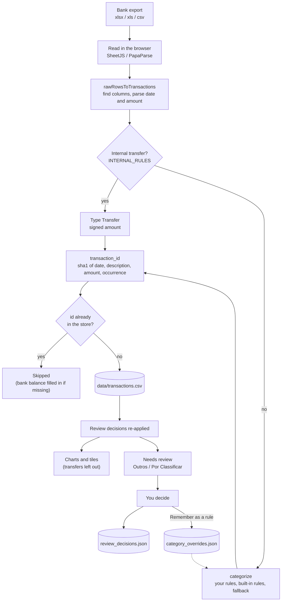

# Pipeline overview

What happens to a transaction between the bank's export and a chart. All of it runs in the
browser; the code is `dashboard/engine.js` (reading and categorizing) and `dashboard/index.html`
(merging, reviews, analytics).

To watch it happen on synthetic transactions, one step per cell, run
[`notebook/pipeline_walkthrough.ipynb`](../notebook/pipeline_walkthrough.ipynb).

## Reading the export

- **Columns** are found by alias: `Data Operação`, `Descrição`, `Montante( EUR )` and
  `Saldo Contabilístico( EUR )` (optional), plus a few spellings each (`DATE_ALIASES` and friends
  in engine.js).
- **Dates** are day-first (`06-04-2026`) or ISO.
- **Amounts** are read in either convention: whichever of `.` or `,` comes last is the decimal
  point, so `1.234,56` and `1,234.56` both read as 1234.56. A trailing minus (`12,34-`) is a debit.
- A row whose date or amount can't be read is **skipped and counted**; the import report says how
  many.

## The meal card

A meal card (Cartão Alimentação) export is imported like any bank export, with one difference:
every row gets Method `Cartão Alimentação`, and money in is `Salário Alimentação` (the allowance).
A file counts as one when "These are meal card exports" is ticked at upload or its name contains
"alim", "refei" or "meal" (`isMealCardFile`). That, and the old tracker's own flag, are the only
sources of the method: descriptions, rules and the review panel never set it. Data health checks it.

## The transaction id

`transaction_id = sha1("date|description|amount")[:16]`, with the description lowercased.

Because the id is derived from the transaction itself, re-importing a file is a no-op, and two
exports that overlap de-duplicate on their own.

The catch is a transaction that genuinely repeats: two −8,00 € at the same place on the same day
hash the same. Without a fix the second one would be dropped as a duplicate. Now each repeat inside one file gets an occurrence
number: the first keeps the plain key (so no existing id changed), the second hashes
`date|description|amount|2`, the third `|3`. Re-importing the same file numbers them the same way.

## Internal transfers

"Transferência entre contas" and "Reforco Crp" are money moving between your own accounts. They
are stored with `Type = Transfer`, `Category = Transferências Internas`, and a **signed** amount
(+ in, − out). They are never income or spending: `analysisRows()` leaves them out of every chart
and tile. They show in the Transactions table (filter "Internal transfer") and in the bank check.

To add another pattern, add it to `INTERNAL_RULES` in rules.js and a sub-category under
`TAXONOMY.Transfer`. Rows already in the store that match are moved to Transfer on the next load,
unless you reviewed them by hand.

## The bank balance

When the export has `Saldo Contabilístico`, each row keeps it in `Balance (€)`. Two uses:

- **Latest balance**: the balance after the most recent transaction.
- **Reconciliation** (`reconcileWithBank`, shown in Data health): the closing balance minus the
  opening balance must equal the sum of every stored row that carries a balance. A non-zero gap
  means a transaction is missing, doubled, or an export leaves a period uncovered.

Rows without a balance (meal card, manual entries, the old Excel tracker) live in other pockets
and take no part.

## Merging into the store

The store is append-only. An import adds rows whose id is new; a known id is a duplicate, and the
only thing it may change is filling in a missing bank balance. The local server refuses any save
that would remove a transaction (409), except the confirmed "Replace all history", which backs the
old file up first.

## Reviews

A review (category, sub-category, method, note, timestamp) is kept in three places: the row itself,
the browser's localStorage, and `data/review_decisions.json`, keyed by transaction id. On every load
and import the decisions are re-applied, so rebuilding the store from the raw exports loses nothing.

## Where analysis happens

All analytics are in `index.html` and read `analysisRows()`: the store without internal transfers,
and without the meal card if that toggle is on. Investments (`Investimentos`) are excluded from
spending (`isSpending`): the money moved, it wasn't spent.
